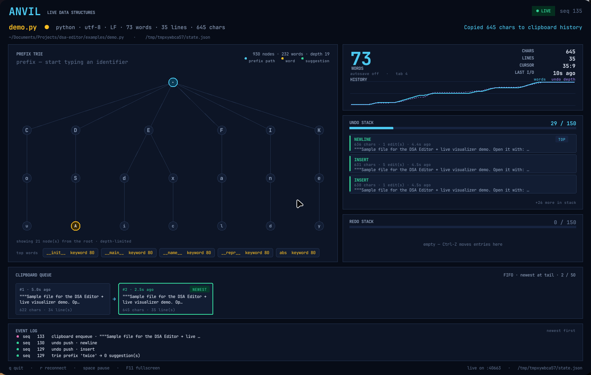

# DSA Editor

**A notepad-like terminal text editor written in C, with hand-written data
structures and a live desktop visualizer.**

The installed commands are **`anvil`** (the editor) and **`anvil-viz`** (the
visualizer). The editor is a single C11/POSIX binary with no external runtime
dependencies. The visualizer remains a separate Tkinter application and reads
the editor only through its public JSON/HTTP bridge.

It opens, creates, edits and saves ordinary text files of any extension
(`.py`, `.js`, `.md`, `.json`, `.csv`, `.sql`, …). It is not a GUI and not an
IDE: the whole editor runs in the terminal, and the undo stacks, completion
trie, clipboard-history queue and live statistics are implemented from scratch
in `src/` rather than delegated to a library.

```
┌──────────────────────────────────────────────────────────────┬────────────────────────────┐
│  1  import re                                                │ DATA STRUCTURES            │
│  2  from dataclasses import dataclass                        │ undo stack      7 / 150    │
│  3                                                           │ redo stack      0 / 150    │
│  4  def word_count(text: str) -> int:                        │ trie nodes   1204   words  │
│  5      return len(re.findall(r"\S+", text))                 │ clipboard       3 / 50     │
│  6                                                           │ ────────────────────────── │
│  7  print(word_count("hello trie"))                          │ DOCUMENT                   │
│                                                              │ demo.py  modified          │
│                                                              │ python · utf-8 · LF        │
│                                                              │ 42 words · 218 chars       │
│                                                              │ autosave 30s · 8s ago      │
│                                                              │ bridge :8765               │
│                                                              │ ────────────────────────── │
│                                                              │ TRIE  prefix 'pri'         │
│                                                              │ print      keyword    80   │
│                                                              │ private    common     45   │
└──────────────────────────────────────────────────────────────┴────────────────────────────┘
 demo.py ● │ python │ Ln 7, Col 1 │ 42 words │ auto on │ bridge :8765
 Ctrl-S save · F3 save as · F4 open · Ctrl-Z/Y undo/redo · F6 panel · F1 help
```

## Live visualizer

`anvil-viz` is a separate desktop application that observes the editor's public
state bridge. It draws the prefix trie, both undo stacks, the clipboard FIFO
queue, live statistics, a history chart and an event log. It never imports
editor internals and never modifies the document.



```bash
# terminal 1
anvil examples/demo.py

# terminal 2
anvil-viz
```

Press `F11` for fullscreen, `Space` to pause, `r` to reconnect and `q` to close.
The full manual is in [`docs/visualizer.md`](docs/visualizer.md).

## Features

| Area | What it does |
|---|---|
| Terminal UI | Full-screen ANSI/termios application; no GUI, no browser, no ncurses |
| Files | Open/create/save any text format; encoding, BOM and newline preservation; atomic saves; binary-file guard |
| Undo / redo | Two hand-written bounded stacks of document snapshots, with typing coalescing |
| Code completion | Character trie seeded with language keywords and learned identifiers; popup plus grey ghost text |
| Syntax highlighting | Built-in lexers selected by file extension or `:lang`; four live colour themes |
| Autosave | On by default every 30 s for files with a path; toggle with `F5` or `:autosave` |
| Word count | Live word/character/line counts in the status bar, side panel and bridge |
| Clipboard history | Bounded FIFO queue; `Ctrl-V` pastes the newest entry, `Alt-1`…`Alt-9` paste older ones |
| Live state bridge | Read-only HTTP server on `127.0.0.1:8765`, atomic JSON state file, and a Python `StateClient` for external observers |
| Live visualizer | Separate Tkinter app (`anvil-viz`) that draws the trie, undo/redo stacks, clipboard queue, stats and event log in real time |

## Build and install

Requirements: a C11 compiler (`cc`), `make`, and a POSIX system (Linux, macOS,
WSL). The editor itself has no third-party libraries. The optional visualizer
needs Python 3.10+ with Tkinter (`python3-tk` on Debian/Ubuntu).

```bash
cd dsa-editor
make                 # builds build/anvil
./install.sh         # builds, installs the visualizer, links both commands
```

`install.sh` links `anvil` (the C binary) and `anvil-viz` (the Python
visualizer) into `~/.local/bin` (or `$XDG_BIN_HOME`) and prints a note if that
directory is not on your `PATH`.

```bash
anvil                  # empty buffer
anvil demo.py          # open or create a file
anvil --help           # all options
anvil-viz              # live visualizer (in a second terminal)
```

You can also install just the binary system-wide:

```bash
sudo make install      # /usr/local/bin/anvil
```

### Run without installing

```bash
./run.sh               # builds if needed, then starts the editor
./run.sh notes.md
./run-viz.sh           # creates .venv on first run, then starts the visualizer
./run-viz.sh --check   # headless one-shot summary
```

## First five minutes

1. `anvil demo.py` opens the file (or creates an empty buffer with that path).
2. Type normally; the trie popup appears after two identifier characters.
3. `Ctrl-S` saves. `Ctrl-Q` quits; press it twice if there are unsaved changes.
4. `F6` shows or hides the live data-structures panel.
5. `F1` opens the in-app help. `F9` or `Ctrl-P` opens the command bar.
6. In a second terminal, `anvil-viz` shows the same structures live.

## Essential keys

| Key | Action |
|---|---|
| `Ctrl-S` / `F2` | Save |
| `F3` | Save as |
| `F4` / `Ctrl-O` | Open |
| `Ctrl-N` | New file |
| `Ctrl-Q` | Quit (twice if unsaved) |
| `Ctrl-Z` / `Ctrl-Y` | Undo / redo (custom stacks) |
| `Ctrl-C` / `Ctrl-X` / `Ctrl-V` | Copy / cut / paste newest clipboard entry |
| `Alt-1` … `Alt-9` | Paste older clipboard entries |
| `Tab` / `Ctrl-Right` | Accept completion / accept ghost suggestion |
| `F5` / `F6` | Toggle autosave / data panel |
| `F1` / `F9` | Help / command bar |

The complete reference, including movement and Emacs-style editing keys, is in
[`docs/keybindings.md`](docs/keybindings.md).

> If your terminal captures `Ctrl-S` / `Ctrl-Q` for flow control, run
> `stty -ixon`, or use `F2` to save and `:q` to quit.

## Command bar

Press `F9` or `Ctrl-P` and type a command:

| Command | Action |
|---|---|
| `:w [path]` | Save, optionally as another path |
| `:wq` | Save and quit |
| `:e path` | Open a file (`:e!` discards changes) |
| `:new` | New file (`:new!` discards changes) |
| `:q` / `:q!` | Quit / quit without saving |
| `:autosave on\|off\|<seconds>` | Configure autosave |
| `:lang python` | Set the syntax language (`:lang auto` detects it) |
| `:find text` | Find next occurrence (wraps) |
| `:goto 42` | Go to line 42 |
| `:theme monokai` | Switch palette: `monokai`, `dracula`, `solarized`, `light` |
| `:tab 4` | Set the soft-tab width |
| `:undo` / `:redo` | History |
| `:panel` | Toggle the data-structure panel |
| `:state` | Show the live bridge URL and state file |
| `:help` / `:clip` / `:path` / `:languages` | Help, clipboard count, path, language list |

## Documentation

| Document | Contents |
|---|---|
| [`docs/manual.md`](docs/manual.md) | Complete user manual: installation, interface, editing, files, commands, autosave, bridge, troubleshooting |
| [`docs/visualizer.md`](docs/visualizer.md) | Live visualizer manual: install, panels, shortcuts, connection modes, demo script |
| [`docs/keybindings.md`](docs/keybindings.md) | Every editor and visualizer keyboard shortcut |
| [`docs/state_api.md`](docs/state_api.md) | JSON schema and HTTP contract for the visualizer |
| [`docs/dsa_notes.md`](docs/dsa_notes.md) | Lecture notes on each data structure and its complexity |
| [`docs/python-app connection.md`](docs/python-app%20connection.md) | How the C editor and Python visualizer share state |
| [`examples/watch_state.py`](examples/watch_state.py) | Minimal live-state consumer |
| [`examples/demo.py`](examples/demo.py) | Sample file for the editor + visualizer demo |

## Data structures at a glance

- **Undo/redo** (`src/undo.c`) — bounded undo and redo stacks of `Snapshot`
  objects. Consecutive
  non-whitespace inserts or backspaces within 0.9 s become one undo unit;
  moving the cursor starts a new one. Both stacks are bounded by capacity and
  total stored characters.
- **Completion trie** (`src/trie.c`) — a character trie with terminal flags,
  ranking weights and kinds (`keyword`, `common`, `word`, `snippet`). It is
  seeded from 21 languages of keywords in `src/keywords_data.h` and learns
  identifiers from the document.
- **Clipboard queue** (`src/clipboard.c`) — a bounded FIFO ring: enqueue at the
  tail, dequeue from the head, `get(n)` from the newest for `Alt-n`.
- **Statistics** (`src/buffer.c`) — an O(n) scan for words, characters,
  non-whitespace characters, lines and cursor position.

Complexity notes and exam-style discussion are in
[`docs/dsa_notes.md`](docs/dsa_notes.md).

## Live state bridge

The C editor builds a complete JSON snapshot from its structures and publishes
it:

- over HTTP at **`http://127.0.0.1:8765/state`**, and
- to **`~/.local/state/dsa-editor/state.json`** (atomic writes, at most once per
  second; `$XDG_STATE_HOME` is respected).

A separate Python process can consume it directly:

```python
from dsa_editor.bridge import StateClient

for snapshot in StateClient().watch():
    print(snapshot["stats"]["words"])
    print(snapshot["undo"]["undo_stack"]["depth"])
    print(snapshot["clipboard"]["entries"])
    print(snapshot["trie"]["suggestions"])
```

Or read the JSON file without HTTP:

```python
from dsa_editor.bridge import default_state_file, read_state_file

snapshot = read_state_file(default_state_file())
```

`dsa_editor` now contains only that read-only bridge library (the editor is the
C binary); the visualizer imports it unchanged.

Useful endpoints:

| Endpoint | Contents |
|---|---|
| `/state` | Complete snapshot |
| `/state?wait=1&since=N&timeout=2` | Long-poll until a newer sequence |
| `/trie?depth=6&limit=2000` | Trie tree on demand (deeper than the snapshot's depth-3 view) |
| `/undo` `/redo` `/clipboard` `/stats` `/file` `/autosave` `/ui` `/document` | Subsets |
| `/health` | Liveness, port, pid, sequence, uptime |

The bridge is local-only (`127.0.0.1`), read-only and CORS-enabled. Disable it
with `--no-server`; disable the JSON file with `--no-state-file`. The full
schema is in [`docs/state_api.md`](docs/state_api.md).

The bundled visualizer is the reference consumer:

```bash
anvil-viz                     # live window, HTTP with JSON-file fallback
anvil-viz --check             # print one snapshot and exit
anvil-viz --check --json      # raw snapshot
anvil-viz --port 9000         # match a non-default editor port
```

## Project layout

```
dsa-editor/
├── src/                    # the entire editor, C11 + POSIX
│   ├── main.c              # argument parsing, startup, shutdown
│   ├── editor.c            # editing model, key dispatch, commands, JSON snapshot
│   ├── ui.c                # ANSI/termios renderer, key decoding, themes
│   ├── buffer.c            # text buffer, cursor, selection, statistics
│   ├── undo.c              # bounded undo/redo stacks and coalescing
│   ├── clipboard.c         # bounded FIFO clipboard history
│   ├── trie.c              # completion trie
│   ├── keywords.c          # keyword seeds per language
│   ├── keywords_data.h     # generated keyword tables (21 languages)
│   ├── highlight.c         # per-language lexers and token colours
│   ├── fileio.c            # encoding/newline detection, atomic save
│   ├── bridge.c            # HTTP server, long-poll, atomic JSON state file
│   ├── util.c              # strings, UTF-8, time helpers
│   └── anvil.h             # shared structs and prototypes
├── dsa_editor/bridge/      # read-only Python client kept for the visualizer
├── dsa_visualizer/         # separate Tkinter visualizer (unchanged)
├── Makefile                # builds build/anvil; `make test` runs the PTY test
├── install.sh              # builds and links `anvil` + `anvil-viz`
├── run.sh                  # zero-install editor launcher
├── run-viz.sh              # zero-install visualizer launcher
├── tests/                  # visualizer + bridge unit tests
├── scripts/pty_smoke.c     # end-to-end editor test through a pseudo-terminal
├── scripts/visualizer_smoke.py # visualizer + screenshot test
├── examples/
│   ├── demo.py             # sample file for the demo
│   └── watch_state.py      # minimal live-state consumer
└── docs/
    ├── manual.md           # complete user manual
    ├── visualizer.md       # visualizer manual
    ├── keybindings.md      # keyboard reference
    ├── state_api.md        # visualizer contract
    ├── dsa_notes.md        # lecture notes on each structure
    └── images/visualizer.png
```

## Testing

```bash
make test                                            # C editor through a real PTY
.venv/bin/python -m unittest discover -s tests -v    # visualizer + bridge tests
```

`make test` builds and runs `scripts/pty_smoke.c`: it starts `build/anvil` in a
pseudo-terminal, types, saves, undoes, copies, quits, then checks the file on
disk, the HTTP endpoints and the final `status: "closed"` JSON snapshot. The
Python tests cover the visualizer's model, tracker and data sources, plus the
bridge client/server library.

## Limitations

- Text only: binary files are refused; there is no hex mode.
- Completion is dictionary/prefix based, not semantic (no LSP).
- Undo uses whole-document snapshots; memory is bounded but not delta-encoded.
- Clipboard history is in memory only and is not persisted between runs.
- Mouse support is intentionally off; select with `Shift+arrows`.
- Autosave overwrites the open file after the interval; turn it off with `F5`
  if that is not wanted during a demo.
- One buffer per editor process; there are no splits or tabs.
- Settings are per-run command-line options or command-bar commands; there is
  no configuration file yet.
- The visualizer needs a graphical session and Tkinter; use `anvil-viz --check`
  on headless machines.

## License

MIT. See [`LICENSE`](LICENSE) and `pyproject.toml`.
