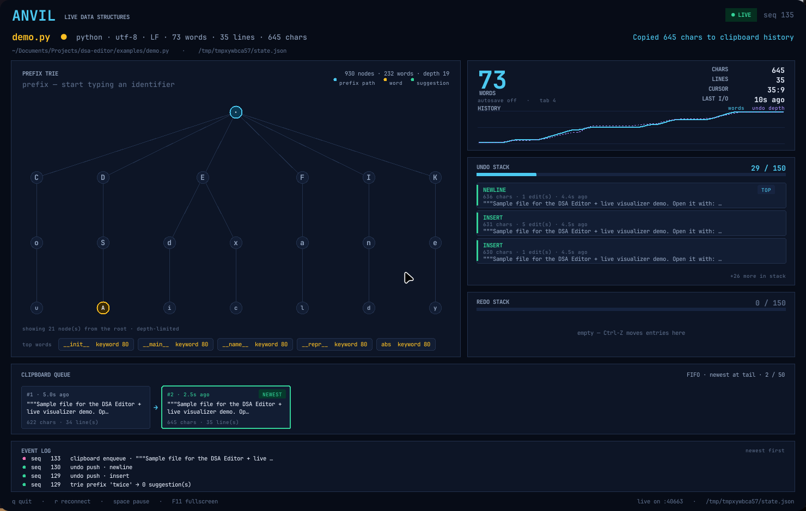

# Live Visualizer

**`anvil-viz`** is a separate desktop application that draws the editor's data
structures while you type.  It reads the editor's public state bridge; it never
imports editor internals and never modifies the document.



The window shows, live:

- the **prefix trie** focused on the identifier under the cursor;
- the **undo stack** and **redo stack**, card by card, with depth and capacity;
- the **clipboard FIFO queue**, oldest entry on the left, newest on the right;
- **word / character / line counts**, cursor position and autosave state;
- a rolling **history chart** of word count and undo depth;
- an **event log** of stack pushes, clipboard enqueues, saves and prefix
  changes.

It is a read-only observer.  Close it at any time; the editor keeps running.

## Contents

1. [Requirements](#1-requirements)
2. [Install](#2-install)
3. [Quick start](#3-quick-start)
4. [Command-line options](#4-command-line-options)
5. [Keyboard shortcuts](#5-keyboard-shortcuts)
6. [Reading the panels](#6-reading-the-panels)
7. [Connection behaviour](#7-connection-behaviour)
8. [Headless check mode](#8-headless-check-mode)
9. [Lecture demo script](#9-lecture-demo-script)
10. [Troubleshooting](#10-troubleshooting)
11. [Architecture](#11-architecture)
12. [Tests](#12-tests)

---

## 1. Requirements

- Python **3.10 or newer**
- **Tkinter** (the standard-library GUI toolkit)
- A graphical desktop session (X11 or Wayland)
- The editor running for live updates, or a state file for a replay

Tkinter is part of Python on most platforms, but some Linux distributions ship
it as a separate package:

| Distribution | Package |
|---|---|
| Debian / Ubuntu / Mint | `sudo apt install python3-tk` |
| Fedora | `sudo dnf install python3-tkinter` |
| Arch | `sudo pacman -S tk` |
| openSUSE | `sudo zypper install python3-tk` |
| macOS (python.org build) | Included |
| Windows | Included; run the editor in WSL and use an X server, or use the state file |

If Tkinter is missing, `anvil-viz` prints a clear message.  You can still use
[`--check`](#8-headless-check-mode) over SSH.

## 2. Install

The visualizer is part of the same package as the editor:

```bash
cd dsa-editor
./install.sh
```

`install.sh` installs the package in editable mode and links both commands into
`~/.local/bin` (or `$XDG_BIN_HOME`):

```text
anvil       the terminal editor
anvil-viz   the live visualizer
```

The venv also contains `dsa-visualizer` as an alias.

### Run without installing

```bash
./run-viz.sh
./run-viz.sh --check
```

or directly:

```bash
.venv/bin/python -m dsa_visualizer
```

## 3. Quick start

Use two terminals.

**Terminal 1 — editor:**

```bash
anvil examples/demo.py
```

**Terminal 2 — visualizer:**

```bash
anvil-viz
```

Type in the editor.  The visualizer updates as you edit: the trie grows,
undo cards appear, the clipboard queue fills and the chart moves.

If the editor uses a non-default port:

```bash
anvil --port 9000 examples/demo.py
anvil-viz --port 9000
```

Put the visualizer on a projector and press `F11` for fullscreen.

## 4. Command-line options

```text
anvil-viz [-h] [--host HOST] [--port PORT] [--state-file PATH]
          [--interval SECONDS] [--geometry WxH] [--no-deep-trie]
          [--check] [--json] [--version]
```

| Option | Default | Meaning |
|---|---|---|
| `--host HOST` | `127.0.0.1` | Editor bridge host |
| `--port PORT` | `8765` | Editor bridge port |
| `--state-file PATH` | XDG path | JSON snapshot used when HTTP is unavailable |
| `--interval SECONDS` | `0.25` | Long-poll/poll interval |
| `--geometry WxH` | `1500x1000` | Initial window size |
| `--no-deep-trie` | off | Use the snapshot's depth-3 trie instead of requesting `/trie` |
| `--check` | — | Print one snapshot summary and exit |
| `--json` | — | With `--check`, print the raw snapshot |
| `--version` | — | Print the version and exit |

The default state-file location is:

```text
$XDG_STATE_HOME/dsa-editor/state.json
```

or, when `XDG_STATE_HOME` is unset:

```text
~/.local/state/dsa-editor/state.json
```

## 5. Keyboard shortcuts

The visualizer window has focus, not the editor.

| Key | Action |
|---|---|
| `q` / `Esc` | Close the visualizer |
| `r` | Reconnect to the editor bridge |
| `Space` | Pause/resume applying new snapshots |
| `F11` | Toggle fullscreen |

Pausing keeps the last snapshot on screen and stops updating the charts; the
editor keeps running.  Press `Space` again to resume.

## 6. Reading the panels

### 6.1 Header

| Field | Meaning |
|---|---|
| `ANVIL / LIVE DATA STRUCTURES` | Application title |
| Pill (`LIVE`, `STATE FILE`, `WAITING`, `PAUSED`, `EDITOR CLOSED`) | Connection mode |
| `seq N` | Snapshot sequence number; it increases on every publish |
| File name and marker | `●` = unsaved changes, `✓` = clean |
| Language · encoding · newline | Detected from the file |
| Word / line / character counts | Live buffer counts |
| Path and state-file path | Where the data comes from |
| Message | The editor's latest status message |

### 6.2 Prefix trie

The trie is focused on the identifier prefix immediately before the cursor.

- **Blue path** — the characters of the current prefix that exist in the trie.
- **Gold node** — a complete word (a terminal node).
- **Green node** — a word in the current completion list.
- **Grey node** — another branch of the trie.
- **Top-left** — the current prefix.
- **Top-right** — total nodes, total words and maximum depth.
- **Bottom chips** — current suggestions with kind and ranking weight, or the
  highest-weighted words when the prefix is empty.
- **Caption** — how many nodes are shown, and whether the view is depth-limited.

The trie learns identifiers at most once per second, so a brand-new long
identifier may not be in the trie immediately.  The caption says so when the
prefix is not found:

```text
prefix 'helper_function' not in the trie yet · deepest match 'hel' · ...
```

The editor publishes a depth-3 tree in each snapshot.  The visualizer normally
requests a deeper tree from `/trie` whenever the prefix changes, then falls back
to the snapshot tree if the request is unavailable.  Use `--no-deep-trie` to
stay on the shallow snapshot view.

### 6.3 Undo and redo stacks

Each card is one snapshot, newest at the top.  The header shows the depth and
the capacity (`29 / 150`), and the bar is the fill ratio.

A card shows:

- the edit label (`INSERT`, `DELETE`, `NEWLINE`, `REPLACE`, …), colour-coded;
- the stored character count, number of coalesced edits and age;
- a one-line preview of the document *before* that edit;
- a `TOP` badge on the newest entry.

The undo header may show `grouping insert` while consecutive typing is being
coalesced into one undo unit.  `+N more in stack` means the stack has more
entries than fit; the depth number is always the true size.

The redo stack is empty until you press `Ctrl-Z`.  A new edit clears it.

### 6.4 Clipboard queue

The clipboard history is a bounded FIFO queue.  Cards run from the oldest entry
on the left to the newest on the right, with an arrow between them.

- The rightmost card is the **newest** and is outlined green.
- `#id` is the queue entry id; the age is time since it was enqueued.
- The footer shows the entry's character and line counts.
- `+N older entries not shown` means the queue holds more than the window can
  display.
- The header shows `size / capacity` (default capacity 50).

`Ctrl-V` in the editor pastes the newest entry; `Alt-1` … `Alt-9` paste older
entries.

### 6.5 Stats and history

- Large number — live word count.
- Right column — characters, lines, cursor line:column, and time since the last
  disk I/O.
- Autosave state and tab width.
- The chart plots word count (blue) and undo depth (purple, dashed) over the
  snapshots seen since the visualizer started.  It fills as you type; it is not
  a historical log from before the window opened.

### 6.6 Event log

The newest events first, up to the height of the panel:

| Event | Meaning |
|---|---|
| `undo push` | A new snapshot was pushed |
| `undo pop` | `Ctrl-Z` restored a snapshot |
| `redo push` / `redo pop` | The redo stack changed |
| `clipboard enqueue` | Copy/cut added an entry |
| `saved …` | A save completed |
| `autosave enabled/disabled` | Autosave was toggled |
| `trie prefix …` | The completion prefix changed |
| `editor closed` | The final snapshot was received |

## 7. Connection behaviour

The visualizer starts a background reader with two channels:

1. **HTTP long-poll** — `GET /state?wait=1&since=N&timeout=0.25` on the editor's
   bridge.  This is the low-latency path.
2. **JSON state file** — read when HTTP is unavailable.  The editor writes it
   atomically at most once per second, plus a final `status: "closed"` snapshot
   on exit.

The pill in the header shows the active mode:

| Pill | Meaning |
|---|---|
| `LIVE` | HTTP snapshots are arriving |
| `STATE FILE` | HTTP is down; reading the JSON file |
| `WAITING` | Neither channel has data yet |
| `PAUSED` | You pressed `Space`; updates are buffered |
| `EDITOR CLOSED` | The final snapshot has `status: "closed"` |
| `CONNECTING` | Initial connection |

When the editor exits, the visualizer keeps the last snapshot on screen so you
can discuss it.  Restart the editor and press `r` to reconnect.

The bridge is read-only and binds to `127.0.0.1` only.  Clipboard text is part
of the snapshot; do not expose the port to a network.

## 8. Headless check mode

No display is needed for a quick data check:

```bash
anvil-viz --check
anvil-viz --check --json
anvil-viz --check --port 9000 --state-file /tmp/state.json
```

Example output:

```text
source     http://127.0.0.1:8765  (seq 42, status ok)
file       demo.py [dirty]  ·  python · utf-8 · LF
counts     73 words · 645 chars · 35 lines · cursor 35:9
undo       29/150  redo 0/150  clipboard 2/50
trie       930 nodes · 232 words · prefix 'pri' -> print, private
state file /home/r/.local/state/dsa-editor/state.json
```

This is useful over SSH, in CI, or when Tkinter is not installed.  It exits
with status 1 if no state is available.

## 9. Lecture demo script

1. Open `examples/demo.py` in the editor and start `anvil-viz` on the projector.
2. Point out the header: file, language, live counts, bridge sequence.
3. Type a new function name slowly.  Watch the trie path grow, the suggestion
   chips appear and the ghost completion in the editor.
4. Press `Ctrl-Right` in the editor to accept the ghost suggestion.  The trie
   weight of that word increases.
5. Type several characters without moving the cursor, then press `Ctrl-Z`.
   One card disappears from the undo stack; the redo stack gains a card.  Press
   `Ctrl-Y` to move it back.
6. Select text with `Shift+arrows`, press `Ctrl-C`, and watch a clipboard card
   appear.  Copy another selection and point out the FIFO order and the `NEWEST`
   badge.  Paste the older entry with `Alt-2`.
7. Press `F5` in the editor to toggle autosave.  The event log records it and
   the stats panel updates.
8. Open a second copy of the visualizer on another monitor with
   `anvil-viz --geometry 1200x800` to show that multiple observers are fine.
9. Press `Space` to pause the visualizer, type in the editor, then resume: the
   view jumps to the newest snapshot.
10. Close the editor.  The pill changes to `EDITOR CLOSED` and the final state
    stays on screen.

## 10. Troubleshooting

### `anvil-viz: command not found`

Re-run `./install.sh` and check that `~/.local/bin` is on `PATH`.

### `tkinter is unavailable`

Install the system package from [Requirements](#1-requirements), or use
`anvil-viz --check`.

### `cannot open the visualizer window`

- Check `DISPLAY` (X11) or `WAYLAND_DISPLAY` (Wayland).
- Over SSH, enable X11 forwarding (`ssh -X`) or use `--check`.
- On WSL, install an X server such as VcXsrv or use WSLg.

### The pill says `STATE FILE` or `WAITING`

- The editor may have been started with `--no-server`.
- The port may be different; pass `--port`.
- The editor may not be running.  Start it, then press `r`.
- The state file may be disabled with `--no-state-file`.

### The window is too large or too small

Use `--geometry`, for example:

```bash
anvil-viz --geometry 1200x800
anvil-viz --geometry 1920x1080
```

`F11` toggles fullscreen.  The layout adapts down to about 1080×720.

### The trie looks empty or shallow

- The prefix may not be in the trie yet; identifiers are learned within a
  second.
- The snapshot tree is depth-limited; the visualizer requests a deeper tree
  automatically unless `--no-deep-trie` is set.
- Very large tries are still budgeted to keep the drawing readable; the caption
  says `depth-limited`.

### The chart is flat

The chart starts when the visualizer starts.  It needs at least two snapshots
with different values; type a few words and it will move.  A flat line is also
correct when the word count and undo depth are genuinely constant.

### Clipboard entries are missing

The queue is in memory only.  Restarting the editor clears it.  Identical
consecutive copies refresh the newest entry instead of adding a duplicate.

### Colours look wrong

Use a modern terminal/font with ANSI colours.  The visualizer uses its own dark
palette and does not follow the editor's Pygments theme.

## 11. Architecture

```text
dsa_visualizer/
├── model.py    pure data/layout helpers: trie lens, tidy tree layout,
│               stack/queue cards, sparkline, change tracker
├── source.py   background HTTP long-poll + JSON-file fallback
├── theme.py    palette, rounded rectangles, text fitting, meters
├── app.py      Tkinter window and canvas drawing
├── cli.py      argparse entry point (`anvil-viz`)
└── __main__.py `python -m dsa_visualizer`
```

Data flow:

```text
editor UI thread
   └── build_state() ──► StateHub ──► HTTP /state ─┐
                                  └─► state.json ──┤
                                                   ▼
                                      LiveSource (background thread)
                                                   │ queue
                                                   ▼
                                      Visualizer._pump (Tk thread)
                                                   │
                         ┌─────────────────────────┼─────────────────────┐
                         ▼                         ▼                     ▼
                   trie canvas              stack canvases         stats/events
```

`model.py` has no Tkinter imports, so it is unit-tested without a display.  The
window only reads from the source queue; it never touches editor objects.

The JSON contract is documented in [`state_api.md`](state_api.md).  The editor
side is described in [`manual.md`](manual.md) and
[`dsa_notes.md`](dsa_notes.md).

## 12. Tests

```bash
.venv/bin/python -m unittest tests.test_visualizer -v
.venv/bin/python -m unittest discover -s tests -v
.venv/bin/python scripts/visualizer_smoke.py
```

`tests/test_visualizer.py` covers the trie lens, tidy layout, card selection,
sparkline bounds, formatting, change tracking and both live-source channels
(HTTP and JSON-file fallback).

`scripts/visualizer_smoke.py` launches the real editor in a pseudo-terminal,
starts the visualizer on the desktop, types into the editor, runs
`anvil-viz --check`, captures a screenshot to `/tmp/opencode/anvil-viz.png`
(using Hyprland + `grim` + ImageMagick when available), and shuts both down.
It is a manual smoke test, not part of the unit suite.
